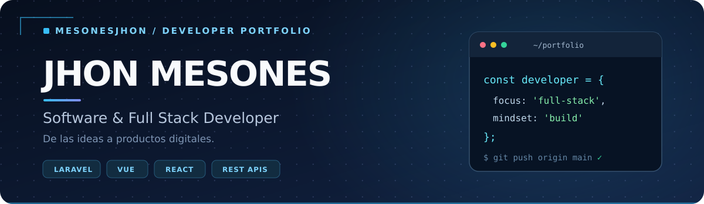

<p align="center">
  
</p>

<p align="center">
  <strong>Desarrollo web Full Stack · Arquitectura de software · APIs REST</strong>
</p>

<p align="center">
  <a href="https://github.com/MesonesJhon?tab=repositories">
    
  </a>
  <a href="https://red-integridad.vercel.app">
    
  </a>
</p>

---

## 👨‍💻 Sobre mí

Soy **Jhon Mesones**, estudiante de **Ingeniería de Sistemas** y desarrollador orientado a construir aplicaciones web completas: desde interfaces claras y accesibles hasta servicios backend bien estructurados.

Me interesa crear soluciones mantenibles, desarrollar **APIs REST**, organizar proyectos con buenas prácticas y mejorar continuamente la calidad del código mediante pruebas y documentación.

- **Frontend:** interfaces web y experiencias centradas en el usuario.
- **Backend:** lógica de negocio, autenticación, integración de servicios y APIs.
- **Ingeniería:** arquitectura, bases de datos, automatización y pruebas.

## 🛠️ Tecnologías y herramientas

**Frontend**

<p>
  
</p>

**Backend y bases de datos**

<p>
  
</p>

**Herramientas**

<p>
  
</p>

## 🚀 Proyectos destacados

| Proyecto | Descripción | Tecnologías | Enlaces |
|:--|:--|:--|:--|
| **Red de Integridad Lambayeque** | Sitio informativo con secciones institucionales, publicaciones y observatorio. | HTML, CSS, JavaScript | [Código](https://github.com/MesonesJhon/red_integridad) · [Demo](https://red-integridad.vercel.app) |
| **Chiclayo Reporta — Landing** | Interfaz web para presentar una plataforma de reportes, características y roles. | React, TypeScript, Vite | [Código](https://github.com/MesonesJhon/Chiclayo_Reporte_Landing) · [Demo](https://chiclayo-reporte-landing.vercel.app) |
| **Sistema de reservas de pasajes — API** | Backend con rutas API v1 para autenticación, viajes, asientos, reservas, pagos y tickets. | PHP, Laravel | [Código](https://github.com/MesonesJhon/Backend_Sis_Reservas_Pasajes) |

> Los enlaces apuntan únicamente a repositorios públicos. Los proyectos privados pueden incorporarse cuando tengan documentación o demostraciones aptas para compartir.

## 🎯 En qué me enfoco

```text
01. Construir interfaces claras y funcionales.
02. Diseñar servicios y APIs mantenibles.
03. Documentar, probar y mejorar cada entrega.
```

## 📫 Contacto

¿Quieres revisar un proyecto, intercambiar ideas o colaborar?

**[Explorar mis repositorios en GitHub →](https://github.com/MesonesJhon?tab=repositories)**

<p align="center"><sub>Diseñado para mostrar código, proyectos y aprendizaje continuo.</sub></p>
